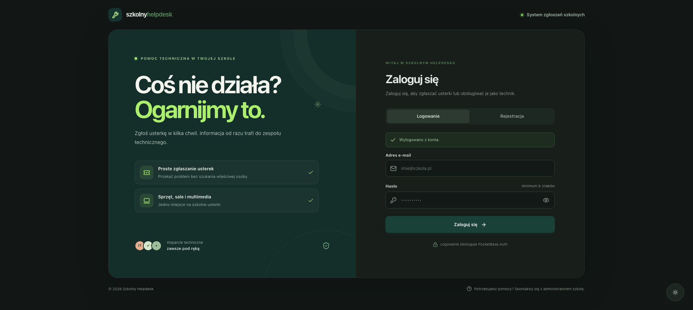
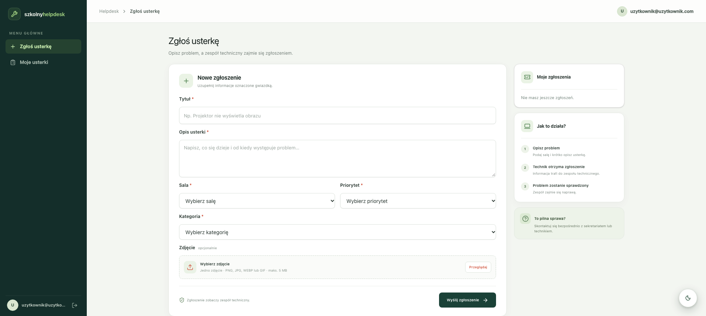
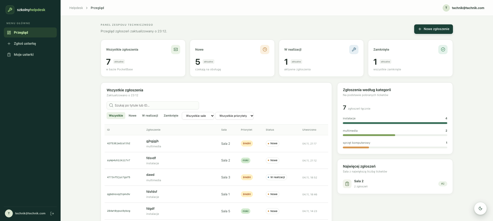

# Szkolny Helpdesk

Szkolny Helpdesk to aplikacja webowa do zgłaszania usterek w szkole i obsługi
zgłoszeń przez zespół techniczny. Użytkownik może utworzyć konto, dodać
zgłoszenie z opisem, salą, kategorią, priorytetem i zdjęciem, a następnie
śledzić jego status oraz komentarze. Technik ma osobny widok do przeglądania,
filtrowania i aktualizowania zgłoszeń.

Aplikacja korzysta z [Next.js](https://nextjs.org/) po stronie interfejsu oraz
z [PocketBase](https://pocketbase.io/) jako backendu i bazy danych.

## Spis treści

- [Najważniejsze funkcje](#najważniejsze-funkcje)
- [Zrzuty ekranu](#zrzuty-ekranu)
- [Uruchomienie lokalne](#uruchomienie-lokalne)
- [Konfiguracja PocketBase](#konfiguracja-pocketbase)
- [Wdrożenie w Coolify](#wdrożenie-w-coolify)
- [Konta testowe](#konta-testowe)
- [Polecenia](#polecenia)

## Najważniejsze funkcje

### Użytkownik

- rejestracja i logowanie przez PocketBase Auth,
- zgłaszanie usterek z tytułem, opisem, salą, kategorią i priorytetem,
- dodawanie zdjęcia do zgłoszenia,
- podgląd statusu zgłoszenia,
- przeglądanie historii zmian statusu i komentarzy,
- dodawanie komentarzy do własnych zgłoszeń,
- przełączanie jasnego i ciemnego motywu.

### Technik

- lista wszystkich zgłoszeń,
- filtrowanie po statusie, sali i priorytecie,
- zmiana statusu zgłoszenia,
- dodawanie komentarzy,
- podgląd historii zmian i danych zgłoszenia,
- automatyczne odświeżanie listy po zmianach w PocketBase.

Obsługiwane statusy to: `nowe`, `w realizacji` i `zamknięte`. Kategorie
zgłoszeń to: `sprzęt komputerowy`, `multimedia`, `instalacje` i `inne`.

## Zrzuty ekranu

### Ekran logowania i rejestracji



### Panel użytkownika



### Panel technika



## Uruchomienie lokalne

### Wymagania

- Node.js w wersji zgodnej z używanym środowiskiem projektu,
- npm,
- uruchomiona instancja PocketBase.

### Instalacja

1. Sklonuj repozytorium i przejdź do katalogu projektu:

   ```bash
   git clone https://github.com/Veresek/szkolny-helpdesk
   cd szkolny-helpdesk
   ```

2. Zainstaluj zależności:

   ```bash
   npm install
   ```

3. Utwórz plik `.env` w katalogu głównym projektu:

   ```env
   NEXT_PUBLIC_POCKETBASE_URL=https://database.twintracks.xyz
   ```

   Wartość musi wskazywać na adres PocketBase dostępny z przeglądarki. Nie
   dodawaj pliku `.env` do repozytorium.

4. Uruchom serwer deweloperski:

   ```bash
   npm run dev
   ```

5. Otwórz [http://localhost:3000](http://localhost:3000).

Do uruchomienia wersji produkcyjnej lokalnie:

```bash
npm run build
npm run start
```

## Konfiguracja PocketBase

W PocketBase utwórz następujące kolekcje:

- `users` — kolekcja uwierzytelniania z polem `role`,
- `tickets` — zgłoszenia usterek,
- `ticket_events` — historia zmian statusów,
- `ticket_comments` — komentarze do zgłoszeń.

Wartości pola `role` używane przez aplikację to:

- `uzytkownik` — konto użytkownika,
- `technik` — konto technika.

Rejestracja z poziomu aplikacji zawsze tworzy konto z rolą `uzytkownik`.
Nadanie roli `technik` wykonaj ręcznie z poziomu panelu administracyjnego
PocketBase. Reguły dostępu kolekcji powinny ograniczać użytkownikowi dostęp
do jego własnych zgłoszeń, komentarzy i danych, a technikowi umożliwiać
obsługę wszystkich zgłoszeń.

Wymagana konfiguracja pól odpowiada typom w
[`src/types/pocketbase.ts`](src/types/pocketbase.ts):

- `tickets`: `user_id`, `title`, `description`, `room`, `category`,
  `priority`, `status`, `comment`, `photo`,
- `ticket_events`: `editor_id`, `relation`, `old_status`, `new_status`,
- `ticket_comments`: `commenter_id`, `ticket_id`, `comment`.

## Wdrożenie w Coolify

Wdrożenie składa się z dwóch usług połączonych ze sobą adresem HTTP:

1. **Szkolny Helpdesk — frontend** — aplikacja Next.js z tego repozytorium.
2. **PocketBase — backend** — instancja API i bazy danych.

### Usługa frontendowa

W Coolify utwórz aplikację z repozytorium Git i ustaw:

- **Build Pack:** `Nixpacks` lub konfigurację używaną w projekcie,
- **Build command:** `npm run build`,
- **Start command:** `npm run start`,
- **Port:** `3000`,
- **Node.js:** wersja zgodna z lokalnym środowiskiem projektu.

W zmiennych środowiskowych usługi dodaj:

```env
NEXT_PUBLIC_POCKETBASE_URL=https://database.twintracks.xyz
```

Adres musi być publicznie dostępny dla przeglądarki użytkownika, ponieważ
aplikacja komunikuje się z PocketBase bezpośrednio po stronie klienta.

### Usługa PocketBase

Utwórz w Coolify osobną usługę PocketBase, korzystając z wybranego obrazu lub
konfiguracji Docker:

- **Health check:** `GET /api/health`.

#### Trwały wolumen

Dodaj trwały wolumen, aby dane nie zniknęły po ponownym wdrożeniu lub
odtworzeniu kontenera:

| Usługa | Ścieżka w kontenerze | Zawartość |
| --- | --- | --- |
| PocketBase | `/pb/pb_data` | baza danych, pliki i załączniki |

Jeżeli używany obraz PocketBase ma inną ścieżkę danych, dopasuj ścieżkę
montowania do dokumentacji tego obrazu. Panel administracyjny PocketBase jest
dostępny pod adresem `https://database.twintracks.xyz/_/`.

### Kolejność wdrożenia

1. Utwórz usługę PocketBase i skonfiguruj wolumen.
2. Utwórz kolekcje, reguły dostępu i konto technika w PocketBase.
3. Ustaw domenę PocketBase i sprawdź `GET /api/health`.
4. Utwórz usługę frontendową i dodaj `NEXT_PUBLIC_POCKETBASE_URL`.
5. Wdróż frontend i sprawdź logowanie, rejestrację, dodawanie zgłoszenia oraz
   zmianę statusu przez technika.

Przed użyciem produkcyjnym skonfiguruj HTTPS dla obu usług, zmień dane kont
administracyjnych i wykonaj kopię zapasową wolumenu `/pb/pb_data`.

## Konta testowe

| Rola | Adres e-mail | Hasło | Przeznaczenie |
| --- | --- | --- | --- |
| Użytkownik | `uzytkownik@uzytkownik.com` | `adminadmin` | Dodawanie i śledzenie zgłoszeń |
| Technik | `technik@technik.com` | `adminadmin` | Obsługa zgłoszeń i zmiana statusów |

## Polecenia

- `npm run dev` — uruchamia serwer deweloperski.
- `npm run build` — tworzy produkcyjny build aplikacji.
- `npm run start` — uruchamia build produkcyjny.
- `npm run lint` — sprawdza kod za pomocą ESLint.

